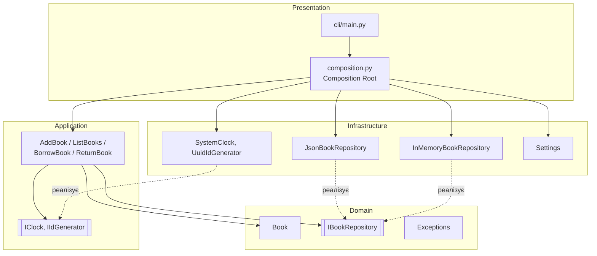

# LibraryApp

Консольний застосунок для обліку книг у бібліотеці: додавання книг,
перегляд каталогу, видача книг читачам та повернення.

Навчальний проєкт з дисципліни «Сучасні технології проєктування»,
лабораторна робота №5 «Побудова архітектури застосунку. Робота з Git».

Автор: Семененко Владислав, група 4КІ1.

## Політика гілок

| Гілка        | Призначення                                                    |
|--------------|----------------------------------------------------------------|
| `main`       | лише стабільний, перевірений код; кожен реліз позначається тегом |
| `develop`    | інтеграційна гілка, куди зливаються всі завершені задачі        |
| `feature/*`  | гілки під конкретні задачі, створюються від `develop`          |

Зміни потрапляють у `develop` тільки через pull request з рев'ю.
Повідомлення комітів оформлюються за конвенцією Conventional Commits
(`feat`, `fix`, `refactor`, `test`, `docs`, `chore`).

## Архітектура

Застосунок побудовано за принципами **Clean Architecture**. Залежності
спрямовані лише всередину: зовнішні шари знають про внутрішні, але не навпаки.



```
 ┌──────────────────────────────────────────────┐
 │ Presentation   cli/main.py, composition.py   │
 │  ┌────────────────────────────────────────┐  │
 │  │ Infrastructure  Json/InMemory repos,   │  │
 │  │                 SystemClock, Settings  │  │
 │  │  ┌──────────────────────────────────┐  │  │
 │  │  │ Application   use cases, DTO,    │  │  │
 │  │  │               IClock, IIdGen     │  │  │
 │  │  │  ┌────────────────────────────┐  │  │  │
 │  │  │  │ Domain  Book, exceptions,  │  │  │  │
 │  │  │  │         IBookRepository    │  │  │  │
 │  │  │  └────────────────────────────┘  │  │  │
 │  │  └──────────────────────────────────┘  │  │
 │  └────────────────────────────────────────┘  │
 └──────────────────────────────────────────────┘
        залежності спрямовані лише всередину
```

### Структура каталогів

```
src/library/
├── domain/            # сутності та бізнес-правила, без залежностей
│   ├── entities/book.py
│   ├── interfaces/book_repository.py   # IBookRepository
│   └── exceptions.py
├── application/       # use cases, залежать лише від domain
│   ├── dto.py
│   ├── interfaces/services.py          # IClock, IIdGenerator
│   └── use_cases/ add_book, list_books, borrow_book, return_book
├── infrastructure/    # реалізації інтерфейсів
│   ├── repositories/ json_book_repository, in_memory_book_repository
│   ├── services.py
│   └── settings.py
└── presentation/      # точка входу та DI
    ├── composition.py
    └── cli/main.py
```

## Збірка і запуск

Потрібен Python 3.10+. Сторонніх залежностей немає.

```bash
git clone <url-репозиторію> library-app
cd library-app
python -m venv .venv
source .venv/bin/activate          # Windows: .venv\Scripts\activate
pip install -e .
```

Приклади використання:

```bash
library add "Кобзар" "Тарас Шевченко" 1840
library list
library borrow <id> "Олена Коваль" --days 10
library list --available
library return <id>
```

Без встановлення: `PYTHONPATH=src python -m library list`
(Windows PowerShell: `$env:PYTHONPATH="src"; python -m library list`).

Тип сховища задається в `config/appsettings.json` (`Storage.Type`: `json` або `memory`).

## Тести

```bash
PYTHONPATH=src python -m unittest discover -s tests -v
```
